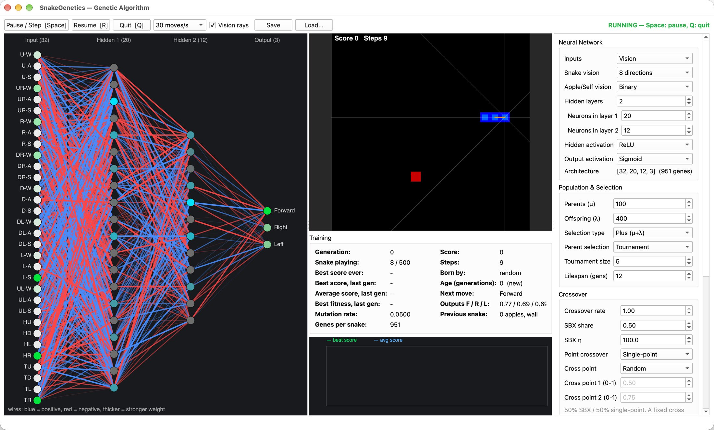

# SnakeGenetics — a Snake AI trained by a Genetic Algorithm

A neural network learns to play the game in `SnakeGame/` (used as is, never changed)
through a genetic algorithm.



**Full guide to every part of the dashboard:** [docs/dashboard.html](docs/dashboard.html)
(open it in a browser).

## Run
`SnakeGame/` is a git submodule ([yhur/SnakeGame](https://github.com/yhur/SnakeGame)), so clone with:
```shell
git clone --recurse-submodules <this repository>
# or, in an existing clone:  git submodule update --init
```

```shell
pip install -r requirements.txt
python main.py                               # dashboard: watch it learn, one snake at a time
python main.py --headless                    # no window: train as fast as possible, Ctrl+C to stop
python main.py --headless -g 500             # ... stop after 500 generations
python main.py --load saves/checkpoint_vision.npz   # continue from a checkpoint (either mode)
```

A good way to use it: train with `--headless`, then open the checkpoint in the dashboard
(`--load`, or **Load...**) and watch the trained snakes play.

| Key   | Action |
|-------|--------|
| Space | pause; while paused, one move per press |
| R     | resume |
| Q     | quit |

## The idea in one paragraph
Every snake has a brain: a small neural network whose weights are one long list of numbers,
its **genome**. A **generation** is 500 snakes. Each plays one game and gets a **fitness**
(apples count a lot, survival a little). The fittest 100 **survive**. Parents are picked from
them, **crossed over** into children, and the children are **mutated**. Survivors + 400 children
are the next generation. Repeat, and the snakes get better.

## The dashboard in brief
| Area | What it shows |
|------|---------------|
| **Toolbar** | Pause/Step, Resume, Quit, speed, vision rays on/off, Save, Load, and the run state |
| **Network** (left) | the brain of the snake playing. Wires: blue = positive weight, red = negative, thicker = stronger. Neurons light up when they fire; the chosen move is green |
| **Game** (middle) | the original `GameBoard`, with vision rays: grey to the wall, orange = sees its own body, green = sees the apple |
| **Training** (below the game) | generation, which snake is playing (`37 / 500`), best and average scores, and details of the snake on screen: score, steps, how it was born, age, its outputs and next move |
| **Chart** | best and average score per generation |
| **Settings** (right) | inputs and brain shape, population and selection, crossover, mutation, game. **Apply** uses them. The mouse wheel changes a setting only after you click it |

## Settings, checkpoints and the two modes
* **Apply** saves the settings to `settings.json`; both modes start from it, so `--headless`
  uses what you last applied in the dashboard.
* **Brain settings** (layers, neurons, activations, inputs, vision) must match the saved snakes, so a
  loaded checkpoint brings its own. Everything else can be changed any time; Apply asks
  whether to keep the current snakes.
* **Save** and headless mode write checkpoints (`saves/*_vision.npz` or `saves/*_simple.npz`): settings, all 500 genomes,
  history and the best snake.
* The dashboard plays one snake at a time. Only `--headless` runs games in parallel.

## Inputs, outputs, fitness
* **Inputs** (setting "Inputs"):
  * **Vision** (default), 32 numbers: for each of 8 directions: 1/distance to the wall, apple
    seen, own body seen; then the head direction and the tail direction (4 numbers each).
    4 directions and 1/distance vision are options.
  * **Simple**, 14 yes/no numbers: a wall forward / right / left, the moving direction
    (R, D, L, U), its own body forward / right / left, and where the apple is (left, right, up,
    down of the head). It learns much sooner, because the answers are handed to it, but it
    sees only one cell ahead, so long snakes trap themselves. The board outlines those three
    cells: green = safe, red = wall or body.
* **Outputs (3):** forward, right, left (the game's own move encoding). The biggest one wins.
* **Fitness:** `steps + 2^apples + 500·apples^2.1 − apples^1.2·(0.25·steps)^1.3`.
  Moves spent circling before starving do not count.
* **Endless loops:** when a snake returns to a state it was already in since its last apple,
  it would circle forever, so it is stopped and scored as if it had starved.

## Code, in reading order
| File | What it shows |
|------|---------------|
| `GeneticAI/network.py`  | the brain: a genome cut into weights, and `forward()` |
| `GeneticAI/snake_ai.py` | one snake: `look()` → `think()` → `step()`, loop check, fitness |
| `GeneticAI/genetic.py`  | `next_generation()`: survivors → parents → crossover → mutation |
| `Dashboard/main_window.py` | the training loop on screen: snake 1, 2, 3 … then `next_generation()` |
| `GeneticAI/config.py`   | every setting, with defaults |
| `GeneticAI/headless.py` | the fast mode: same algorithm, games in parallel |
| `GeneticAI/checkpoint.py` | save / load |

Learning varies a lot from run to run: most runs reach 3–5 apples in 150 generations, some take
off to 20–40, and long runs go further. If a run stalls, start another or let it run longer.

Based on the ideas of Chrispresso's SnakeAI (fitness function and overall design).
